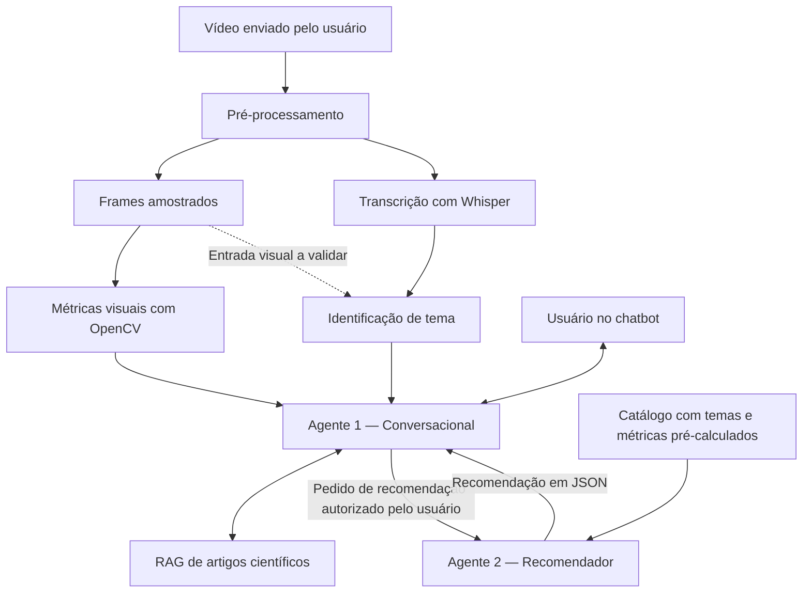

# sensIA

Projeto experimental de Inteligência Artificial para analisar características visuais de vídeos, explicar os resultados com apoio de artigos científicos e recomendar conteúdos de tema semelhante com menor intensidade nas dimensões medidas.

Desenvolvido em equipe na Residência em Inteligência Artificial do Instituto ELDORADO em parceria com a PUC-Campinas, pela metodologia Challenge Based Learning.

Em desenvolvimento · Entrega final prevista: **11/12/2026**.

## Objetivo

Apoiar escolhas mais informadas sobre conteúdos audiovisuais por meio da integração de visão computacional, processamento de linguagem natural, recuperação de evidências científicas e agentes de IA.

O sistema proposto recebe um vídeo, analisa suas características visuais, identifica sua temática e apresenta explicações em uma interface conversacional. Quando o usuário desejar, busca alternativas com temas semelhantes e menor intensidade nas métricas comparáveis.

### Estado atual
O projeto está em desenvolvimento. 
O fluxo completo abaixo representa a arquitetura prevista e ainda não corresponde a uma aplicação integrada de ponta a ponta.

| Componente | Situação |
|---|---|
| Documentação, estrutura do repositório e inventário de dados | Estrutura inicial organizada |
| Agente conversacional | Protótipo em notebook com Llama 3.2 3B via Ollama; integração à aplicação pendente |
| RAG de artigos científicos | Protótipo com extração de texto de PDFs, divisão em trechos, recuperação lexical por TF-IDF e referências de origem |
| Análise visual com OpenCV | Código de protótipo para amostragem de frames e cálculo de brilho, saturação e diferença absoluta entre frames |
| Transcrição do áudio com Whisper | Integração prevista |
| Identificação temática com rede neural | Em definição e desenvolvimento; dataset, entradas e estratégia de aprendizagem a consolidar |
| Agente recomendador e catálogo de vídeos | Planejados para integração |
| API e interface de chatbot | Integração prevista |
| Classificação dos níveis de estímulo | Critérios experimentais e validação pendentes |

Os protótipos descritos foram desenvolvidos em notebook; sua existência não implica que já estejam integrados aos módulos deste repositório. Caminhos e instruções de execução devem acompanhar a publicação das respectivas versões.

## Fluxo da solução



### 1. Entrada e pré-processamento

O usuário envia um vídeo. O pré-processamento prepara o arquivo, extrai frames e seleciona amostras para análise visual. Em paralelo, o Whisper deverá transcrever o áudio para fornecer texto à etapa de identificação temática.

A política de amostragem e de seleção dos trechos deve ser registrada, pois influencia as métricas e a representatividade da análise. Vídeos sem fala ou com transcrição insuficiente precisam de tratamento explícito.

### 2. Análise visual com OpenCV

A frente visual analisa características relacionadas a brilho, cores, variações entre frames e, conforme os métodos implementados e avaliados, movimento e transições entre planos.

O protótipo atual calcula:

- Brilho médio pelo canal V da representação HSV.
- Saturação média pelo canal S da representação HSV.
- Diferença absoluta média entre frames amostrados em escala de cinza.
- Informações sobre duração analisada e quantidade de frames amostrados.

**Diferença entre pixels não equivale a movimento isolado nem a um detector de cortes.** Essa medida pode combinar movimento, edição e mudanças de iluminação. Métricas de cortes, fluxo óptico ou variação temporal de cores e brilho dependem de implementações e avaliações específicas.

Valores não calculados ou indisponíveis devem ser representados como `null`, acompanhados do motivo, e nunca substituídos por zero.

### 3. Identificação de tema com rede neural

A frente de aprendizagem de máquina deverá identificar a temática do vídeo, utilizando inicialmente o texto transcrito do áudio. O uso adicional de frames ou de representações visuais será definido e validado durante os experimentos.

Exemplos iniciais de temas incluem animais, natureza e cores. A taxonomia precisa distinguir tema de formato: “desenho animado”, por exemplo, pode coexistir com um tema como “animais”.

A estratégia depende dos dados disponíveis:

- **Classificação supervisionada:** utiliza exemplos rotulados para aprender categorias previamente definidas.
- **Agrupamento não supervisionado:** organiza representações por similaridade, sem rótulos de tema durante o ajuste. Os grupos precisam de análise e nomeação posterior; não equivalem automaticamente a categorias temáticas.

A escolha da arquitetura, do dataset e das métricas de avaliação ainda deve ser consolidada. A rede desta frente tem como objetivo a identificação temática; o plano anterior de usar SHOT para treinar um detector de transições não define mais esta etapa.

### 4. Agente 1 — Conversacional e analista

O Agente 1 coordena a conversa com o usuário e reúne os resultados disponíveis das análises visual e temática. O protótipo utiliza **Llama 3.2 3B via Ollama**, com memória curta e registro das ações.

O **RAG integra este agente** como mecanismo de recuperação de informações: os artigos são processados em trechos, recuperados conforme a consulta e fornecidos como contexto ao LLM. Essa consulta não corresponde a treinamento ou atualização dos pesos do modelo.

Suas responsabilidades previstas são:

- Explicar as métricas calculadas e seus limites de interpretação.
- Consultar artigos científicos relevantes sobre características audiovisuais e seus contextos de estudo.
- Apresentar referências e páginas dos trechos recuperados, quando disponíveis.
- Informar quando os resultados ou as evidências forem insuficientes para responder.
- Aplicar uma classificação experimental de intensidade somente quando houver critérios definidos, documentados e validados para esse uso.
- Perguntar se o usuário deseja alternativas antes de solicitar uma recomendação ao Agente 2.
- Apresentar e explicar as recomendações recebidas.

O protótipo de recuperação utiliza TF-IDF lexical. A adequação da busca entre consultas em português e artigos em outros idiomas precisa ser avaliada; expansão de termos não garante equivalência semântica.

### 5. Agente 2 — Recomendador

O Agente 2 deverá consultar um catálogo de vídeos cujas métricas visuais e informações temáticas tenham sido previamente calculadas.

A preparação do catálogo deverá aplicar procedimentos compatíveis com os usados no vídeo de entrada: extração visual, transcrição quando disponível e identificação temática.

Ao receber uma solicitação do Agente 1, o recomendador deverá:

1. Buscar candidatos com o mesmo tema ou temas semelhantes.
2. Comparar as dimensões visuais disponíveis usando procedimentos compatíveis.
3. Priorizar alternativas com menor intensidade nas dimensões consideradas pela regra de recomendação.
4. Informar os critérios utilizados, os dados ausentes e eventuais compromissos entre dimensões.
5. Retornar os candidatos e as justificativas em JSON para o Agente 1.

Um vídeo pode apresentar menor brilho e maior variação entre frames, por exemplo. Por isso, a recomendação deve declarar quais dimensões foram reduzidas e como a seleção foi feita. Se não houver candidatos comparáveis, o sistema deve informar essa limitação.

## Saídas previstas

Ao concluir a integração, a solução deverá apresentar:

1. **Tema do vídeo**, com indicação do método e das limitações da identificação.
2. **Métricas visuais** e, quando validada, classificação experimental da intensidade nas dimensões analisadas.
3. **Explicações apoiadas em evidências**, com referências aos artigos e aos trechos recuperados.
4. **Vídeos alternativos**, quando solicitados e disponíveis, com temas semelhantes e menor intensidade nas dimensões comparadas.
5. **Explicação das decisões**, incluindo critérios de busca, comparação e seleção das recomendações.

## Tecnologias

| Frente | Tecnologias e métodos |
|---|---|
| Prototipação | Python e Google Colab |
| Análise visual | OpenCV e NumPy |
| Agente conversacional | Llama 3.2 3B e Ollama |
| Recuperação de evidências | Extração de PDFs, divisão em trechos, TF-IDF e Scikit-learn |
| Transcrição prevista | Whisper |
| Identificação temática | Rede neural e representações textuais ou visuais a definir nos experimentos |
| Integração prevista | API, interface de chatbot e comunicação entre agentes em JSON |

## Preparar o ambiente do repositório

Configuração inicial indicada pelo projeto: **Python 3.11**.

```powershell
git clone https://github.com/BeatrizMaranho/sensIA.git
cd sensIA
python -m venv .venv
.venv\Scripts\Activate.ps1
python -m pip install -r requirements.txt
python scripts/inventory_data.py --help
```

No Linux/macOS, ative o ambiente com `source .venv/bin/activate`.

Esses comandos preparam a estrutura inicial e consultam a ajuda do inventário; **não executam o fluxo completo nem iniciam o chatbot**. As dependências e instruções específicas dos notebooks, do Ollama e das futuras integrações devem ser documentadas junto de cada implementação.

Copie `.env.example` para `.env` somente quando necessário à configuração dos serviços. Não versione credenciais, chaves de API ou dados pessoais.

## Organização do repositório

A estrutura inicial reserva os seguintes caminhos. A existência de um diretório não significa que o componente esteja implementado.

| Caminho | Finalidade |
|---|---|
| `src/sensia/metrics/` | Extração e cálculo de métricas visuais |
| `src/sensia/agents/` | Agente conversacional e agente recomendador |
| `src/sensia/rag/` | Ingestão de documentos, recuperação e referências |
| `src/sensia/models/` | Modelos e experimentos de identificação temática |
| `src/sensia/api/` | Integração dos componentes por API |
| `app/` | Interface de chatbot |
| `data/raw/catalog/` | Vídeos locais do catálogo |
| `data/manifests/` | Inventários e divisões dos dados |
| `knowledge/` | Documentos locais e metadados das fontes científicas |
| `configs/` | Configurações versionadas |
| `notebooks/` | Exploração e protótipos experimentais |
| `models/` e `reports/` | Artefatos de modelos e relatórios de experimentos |

Dados brutos, documentos e modelos devem respeitar as licenças e as políticas de versionamento do projeto.

## Documentação

- [Plano, divisão e critérios de entrega](docs/PLANO.md)
- [Dados e compartilhamento](data/README.md)
- [Arquitetura e contratos de integração](docs/ARQUITETURA.md)
- [MLOps e avaliação](docs/MLOPS.md)
- [Metodologia dos experimentos da rede neural](docs/METODOLOGIA_REDE_NEURAL.md)
- [Como contribuir](CONTRIBUTING.md)

Os documentos internos ainda devem ser revisados para refletir o fluxo atualizado. Referências ao piloto SHOT e à rede de detecção de transições pertencem ao planejamento anterior e não descrevem a função atual da frente temática.

## Avaliação e próximos passos

- Consolidar o dataset, a taxonomia de temas e a estratégia de aprendizagem.
- Integrar e avaliar a transcrição com Whisper, incluindo casos sem fala ou com baixa qualidade de áudio.
- Avaliar a identificação temática com métricas adequadas à abordagem escolhida e separar dados de treino e avaliação por vídeo de origem.
- Verificar as métricas visuais em vídeos de referência e registrar parâmetros de amostragem.
- Avaliar a relevância dos trechos recuperados e a correspondência entre afirmações, citações e fontes.
- Definir e validar critérios experimentais antes de emitir níveis de intensidade.
- Preparar o catálogo e avaliar a preservação temática e a redução das dimensões consideradas nas recomendações.
- Integrar os agentes, a API e o chatbot, publicando exemplos reproduzíveis e resultados observados.

## Limites de interpretação

As métricas descrevem características do vídeo. **Não diagnosticam saúde, fadiga, acessibilidade ou efeitos sobre o desenvolvimento infantil.** Menor intensidade nas dimensões medidas não significa automaticamente que um vídeo seja mais saudável ou adequado para todas as pessoas.

Artigos devem ser interpretados conforme sua população, tipo de conteúdo, método e limitações. O RAG não transforma uma associação científica em um limiar universal, nem garante que toda resposta gerada esteja correta.

Cortes entre planos, mudanças semânticas de cena e movimento dentro de um plano são fenômenos distintos. Critérios de análise e recomendação precisam de versão, escopo, justificativa e avaliação.

O SensIA oferece apoio informativo à decisão e preserva a escolha do usuário.
